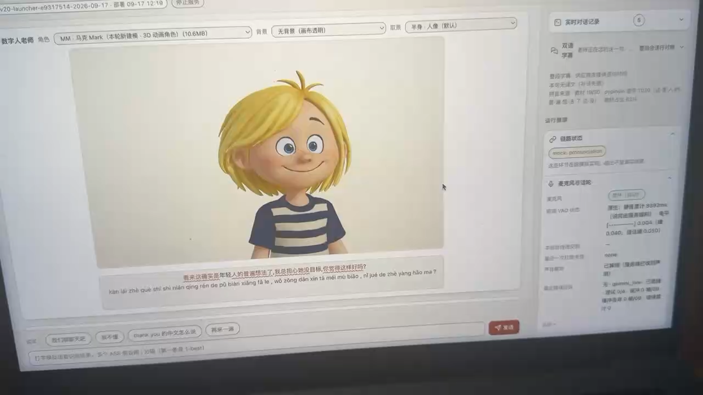
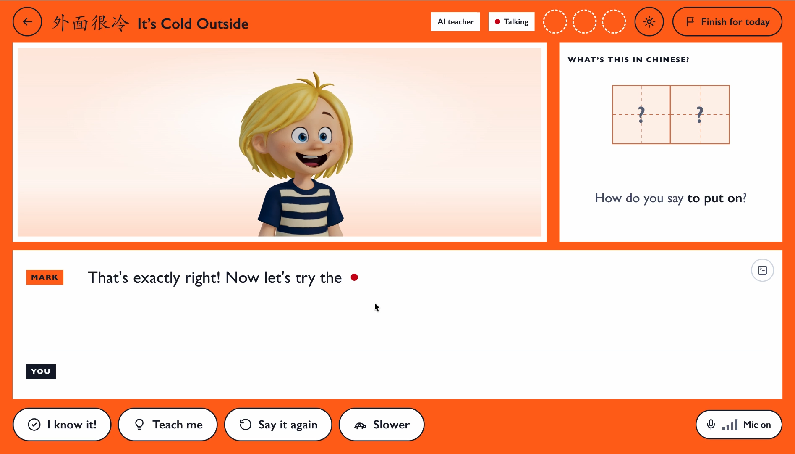
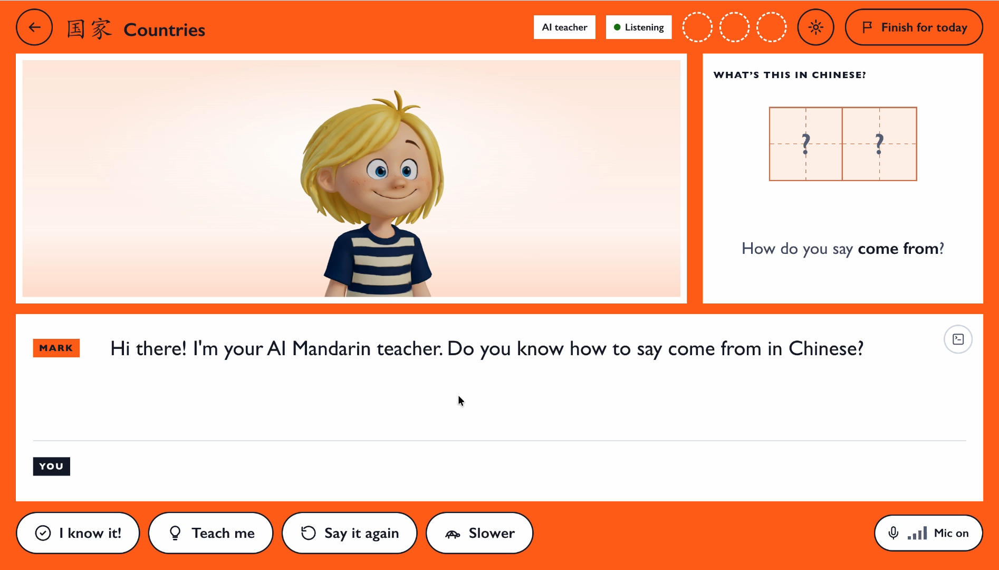

# Mandarin Matrix AI tutor project showcase

Tianyue Fu · Independent software and AI engineering consultant · 2026

**Private portfolio draft. Public release is pending Mandarin Matrix's written permission.**

[中文说明](README.zh-CN.md)

This portfolio presents two stages of a commissioned AI Mandarin-teacher project: an engineering sandbox and a subsequent public-facing interactive prototype. The three videos show development at different points in time. The later prototype remains unfinished.

## My contribution

My work involved clarifying teaching and product requirements, proposing the system architecture, organising teaching assets for the AI pipeline, integrating real-time voice interaction with an animated avatar, developing prototype interfaces, and testing and refining the demonstrations in response to client feedback.

I used AI-assisted coding and modelling tools. My role included directing the workflow, evaluating outputs and resolving integration problems. Mandarin Matrix supplied the original characters, illustrations and teaching content.

## Stage 1 Engineering sandbox

**Status: completed paid sandbox phase.** Video sent to Mandarin Matrix on 20 September 2026.

The engineering interface exposes development controls and diagnostics while demonstrating a live conversation with the Mark avatar. It records the sandbox milestone rather than the later public-facing product.

[Watch or download the complete sandbox video](media/sandbox-engineering-demo.mp4) · 56 seconds

## Stage 2 Public-facing interactive prototype

**Status: work in progress.** Both recordings were sent on 5 October 2026. The agreed next phase targets a web-ready demonstration prototype; these recordings do not represent a completed commercial release.

The examples show the lesson interface, avatar interaction, spoken practice and on-screen dialogue in two course contexts.

| Demo A It's Cold Outside | Demo B Countries |
|---|---|
|  |  |
| [Complete video](media/public-interface-demo-a.mp4) · 1 minute 47 seconds | [Complete video](media/public-interface-demo-b.mp4) · 1 minute 44 seconds |

The public-facing recordings show a local development preview. The display copies preserve their full duration, playback speed and sound, with the browser tab and address bar area removed.

## Mark Character reference and 3D adaptation

The comparison below presents Mandarin Matrix's original Mark illustration and a rendered preview of the Mark avatar adaptation used in the project. This section documents the modelling work and its relationship to the client's existing character.

| Original character illustration | 3D avatar render |
|---|---|
|  |  |

## Credits and rights

Mark is a Mandarin Matrix character. The original character design, illustrations and teaching content belong to Mandarin Matrix. This showcase documents Tianyue Fu's AI-assisted 3D modelling and software integration work for the project.

The current modelling gallery presents Mark.

Publication requires the client's approval of the selected media and description. Display media are presented for portfolio viewing; this showcase does not grant permission to reuse the company's characters or content.

## Timeline

| Date | Milestone |
|---|---|
| August 2026 | Product discussions, blueprint and signed consultancy arrangement |
| 25 August 2026 | Sandbox development start |
| 20 September 2026 | Engineering demonstration video sent |
| 21 September 2026 | Sandbox delivery notice and next prototype phase agreed |
| 5 October 2026 | Two public-facing prototype recordings sent |
| Current status | Later prototype remains under development |

This private repository contains demonstration media and explanatory text. Application source code, 3D model files, contracts, account credentials and private correspondence are outside its display scope.

