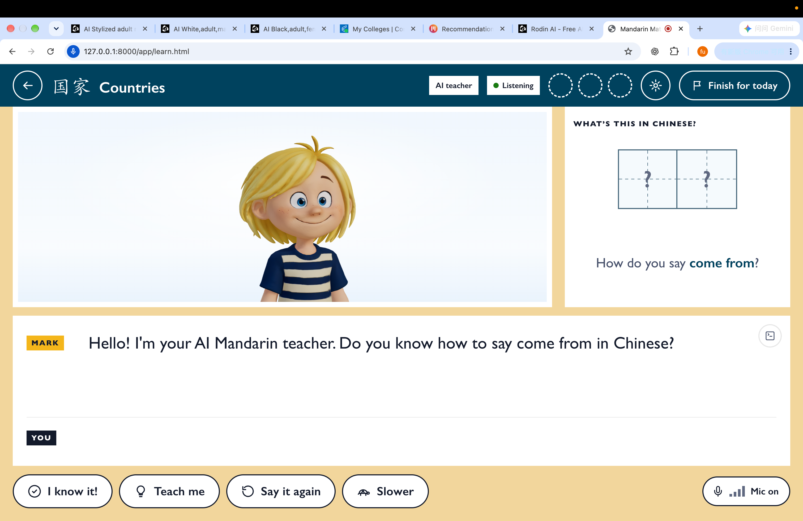
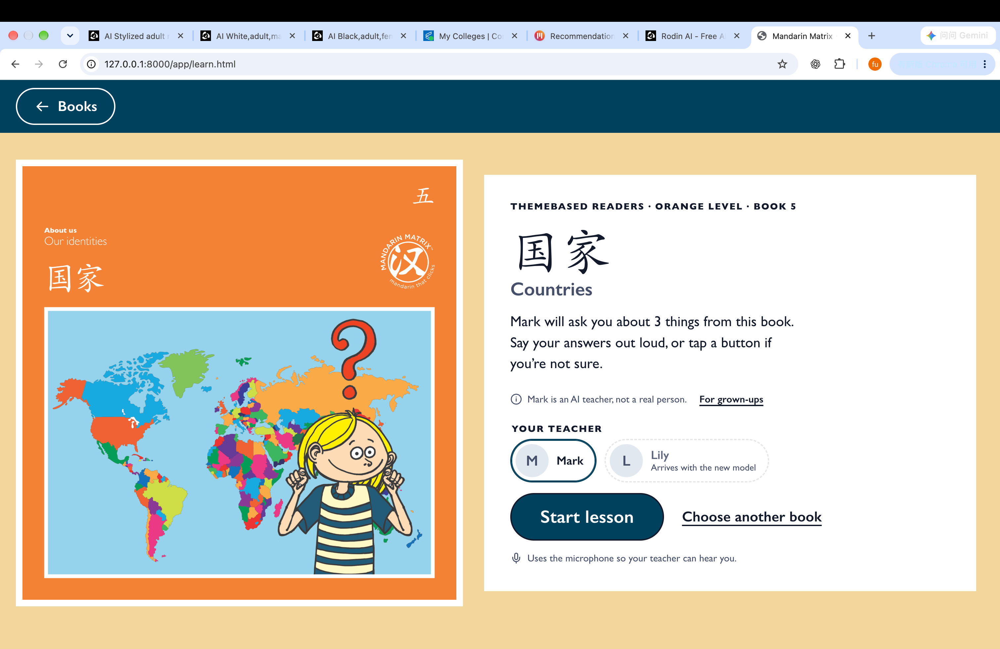
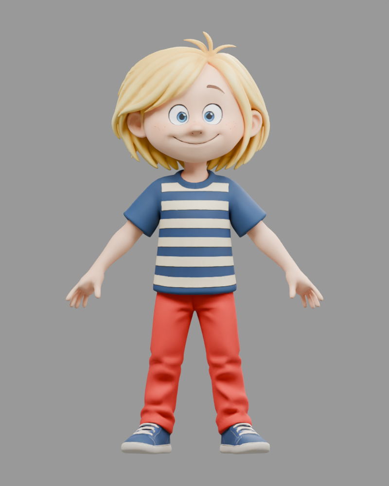
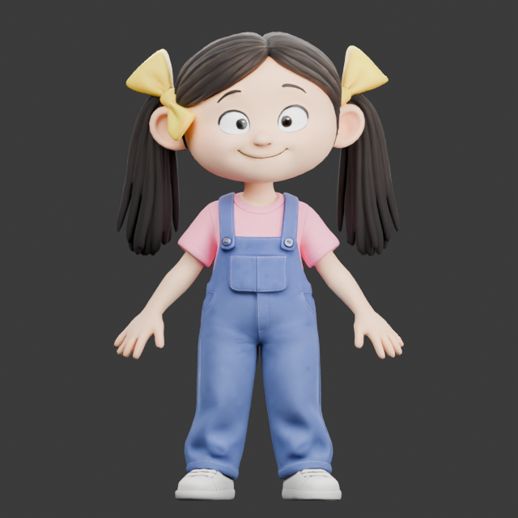
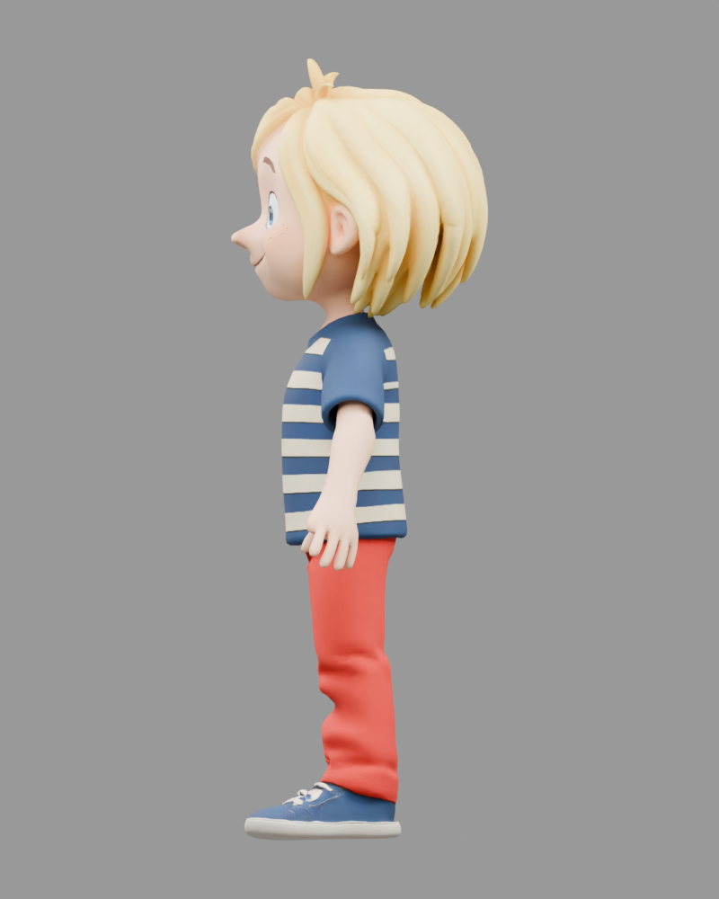
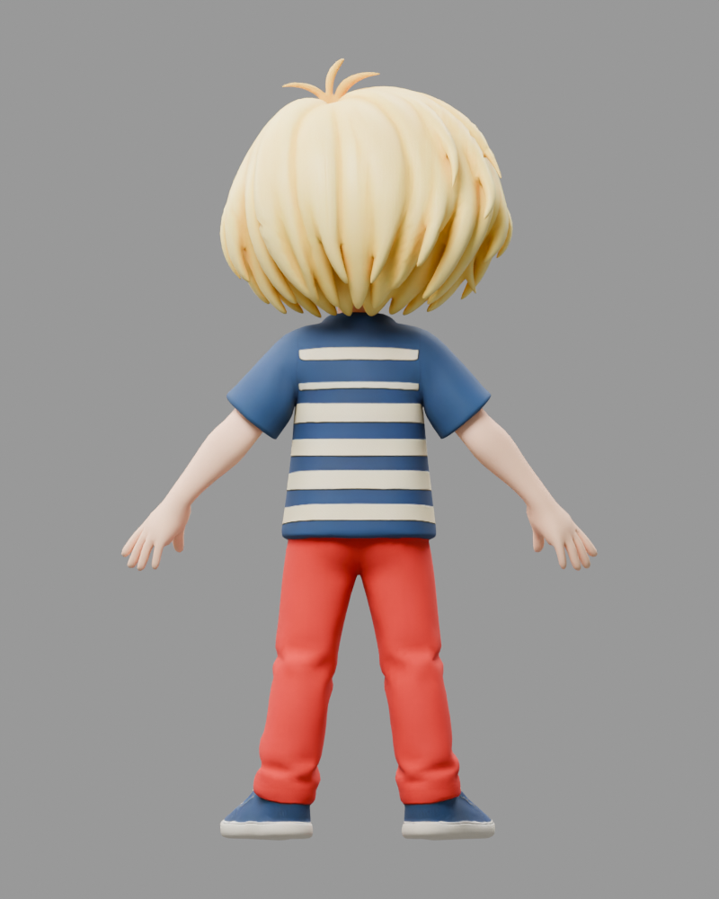
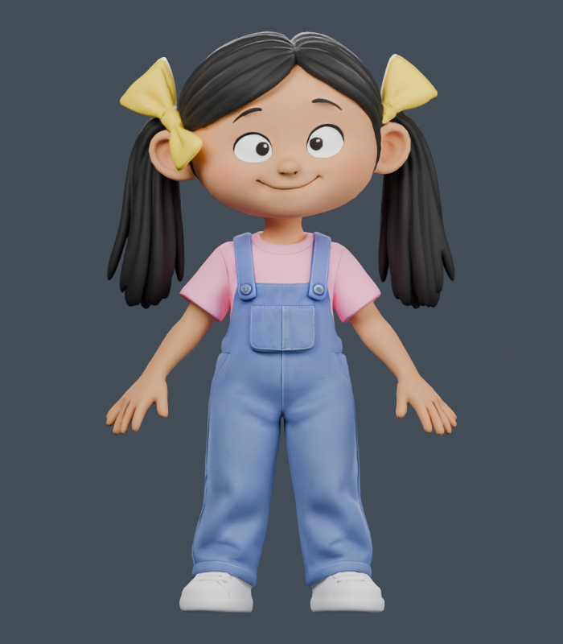
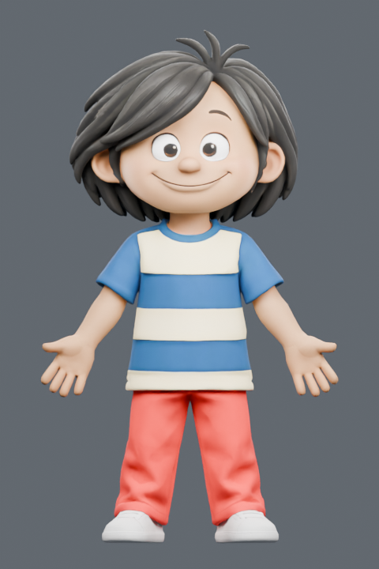
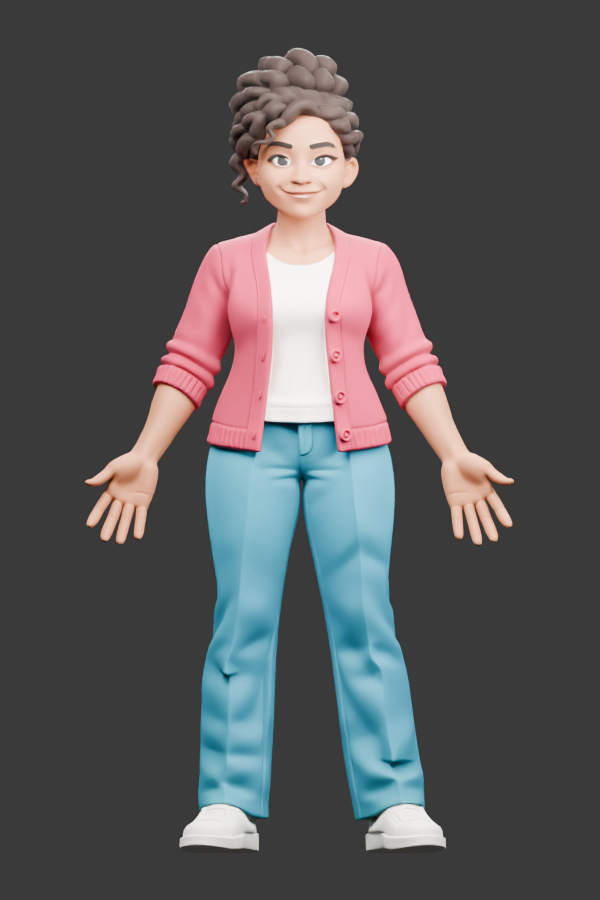

# Mandarin Matrix AI 虚拟老师
**傅天悦 Tianyue Fu · AI 辅助 3D 建模与软件集成 · 2026 年**

[English](README.md) · [产品介绍](docs/product-introduction.md) · [审阅状态](REVIEW.md)

> **私人作品展示审阅稿。** 最新材料日期为 **2026 年 10 月 14 日**。对外展示原型整体仍在开发中，公开前须由 Mandarin Matrix 审阅具体页面和所选素材。

这个网页原型把会说话的 3D 角色与 Mandarin Matrix 分级教材连接起来，让学习者围绕所选书本、词汇和句型进行口语练习。

## 最新界面与录屏 · 2026 年 10 月 14 日

当前演示使用 **Mark**。两张截图和录屏记录的是当天提供给公司的开发中版本。

**[在 GitHub 打开 10 月 14 日完整录屏](https://github.com/SUNNY-Fu-ai/mandarin-matrix-ai-tutor-showcase/releases/tag/untagged-1a1794e5a0ee2cc20f40)**：原始 MOV 放在私人草稿 Release 的附件中，可打开后下载播放。录屏内容保持原样。

| Mark 课程对话 | 书本与课程入口 |
|---|---|
|  |  |

© Mandarin Matrix Limited · 开发中展示

## 公司原画与 3D 建模对照

左侧是 **Mandarin Matrix 原有的二维角色插画**，右侧是项目中的 **3D 外观预览**。原画属于公司；展示记录我的 3D 适配与集成工作。

| 角色 | 公司原画 | 3D 外观预览 |
|---|---|---|
| **Mark** |  |  |
| **Lily** |  |  |

© Mandarin Matrix Limited。对照排版仍属私人审阅稿。

### Mark 三视图

| 正面 | 侧面 | 背面 |
|---|---|---|
|  |  |  |

这三张是原版 Mark 角色的 **3D 渲染图**。源文件名中的 “Original” 用于区别南亚版 Mark，不能误标成公司的二维原画。

### 新角色外观预览

| Lily | 南亚版 Lily | 南亚版 Mark |
|---|---|---|
|  |  |  |

| 成人男性 | 成人女性 |
|---|---|
|  |  |

**仅展示当前外观。** 按 10 月 14 日分享时的说明，这五个新设计的表情、口型同步和动画准备仍在进行；这些图片不代表角色已经完成动画验收或正式上线。© Mandarin Matrix Limited。

## 我的工作

- 设计语音驱动数字人架构并组织开发流程。
- 将 Mark 适配为 3D，开展表情、动画和口型同步工作。
- 整理教材资源，接入课程与对话流程。
- 集成实时语音交互并开发原型界面。
- 根据公司和中文教师的反馈改进教学流程与交互。

开发使用了 AI 辅助编码与建模工具，我负责设定要求、组织工具工作、检查结果和解决集成问题。原角色、插画和教学内容由 Mandarin Matrix 提供。当前产品介绍中使用的语音技术为 xAI 的 Grok。

## 早期阶段演示

### 沙盒工程阶段 · 2026 年 9 月

**沙盒阶段已完成。** 视频于 9 月 20 日发给公司，记录这一工程里程碑。

[完整视频](media/sandbox-engineering-demo.mp4) · 约 56 秒 · © Mandarin Matrix Limited

### 对外展示原型 · 2026 年 10 月 5 日

**开发中。** 保留此前发给公司的两段演示，供查看项目进展。

| 演示 A · 外面很冷 | 演示 B · 国家 |
|---|---|
|  |  |
| [完整视频](media/public-interface-demo-a.mp4) · 约 1 分 47 秒 | [完整视频](media/public-interface-demo-b.mp4) · 约 1 分 44 秒 |

© Mandarin Matrix Limited。原有展示副本保留完整时长、速度和声音，并已裁除浏览器标签与地址栏。

## 署名与知识产权

Mark 和 Lily 是 Mandarin Matrix 拥有的原创角色，相关设计及插画的权利属于 Mandarin Matrix。本展示介绍傅天悦在 AI 工具辅助下完成的 3D 建模与软件集成工作。所有相关知识产权仍属于 Mandarin Matrix，展示仅用于教育与个人作品集。

英文版权声明使用公司提供的简洁版本，见 [English README](README.md#project-credits--intellectual-property-notice)。

© 2026 Mandarin Matrix Limited。展示不转让所有权，也不授予商业再利用许可。

仓库仅收录展示媒体和说明，不含应用源码、3D 模型或建模源文件、合同、项目费用、账号凭据和私人邮件原文。

## 相关文件

[产品介绍](docs/product-introduction.md) · [Word 原件](docs/Mandarin_Matrix_AI_Avatar_Product_Introduction.docx) · [纯文本原件](docs/Mandarin_Matrix_AI_Avatar_Product_Introduction.txt) · [原文件夹说明](docs/00_READ_ME_FIRST.txt) · [素材清单与校验值](docs/asset-manifest.json) · [公开前审阅事项](REVIEW.md)
